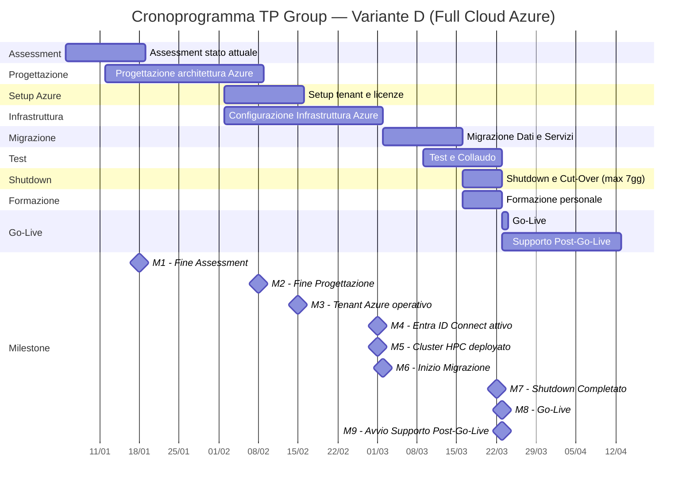

# Cronoprogramma TP Group — Gantt di Progetto

> **Progetto:** Integrazione infrastrutturale TP Group (Thema Consulting + Pro Studio) — **Variante D (Full Cloud Azure)**
> **Durata:** 12 settimane attive (84 giorni)
> **Data inizio:** 05/01/2026
> **Data fine supporto:** 12/04/2026

---

## Diagramma Gantt (Mermaid)

---

## Tabella Riepilogativa

| Attività | Inizio | Fine | Durata | Dipendenze |
|---|---|---|---|---|
| Assessment stato attuale | 05/01/2026 | 18/01/2026 | 14 gg | — |
| Progettazione architettura Azure | 12/01/2026 | 08/02/2026 | 28 gg | Assessment |
| Setup tenant e licenze Azure | 02/02/2026 | 15/02/2026 | 14 gg | Progettazione (parziale) |
| Configurazione Infrastruttura Azure | 02/02/2026 | 01/03/2026 | 28 gg | Progettazione |
| Migrazione Dati e Servizi | 02/03/2026 | 15/03/2026 | 14 gg | Setup tenant, Configurazione Infrastruttura |
| Test e Collaudo | 09/03/2026 | 22/03/2026 | 14 gg | Migrazione Dati (parziale) |
| Shutdown e Cut-Over (max 7gg) | 16/03/2026 | 22/03/2026 | 7 gg | Test e Collaudo |
| Formazione personale | 16/03/2026 | 22/03/2026 | 7 gg | Configurazione Infrastruttura |
| Go-Live | 23/03/2026 | 23/03/2026 | 1 gg | Shutdown, Test e Collaudo |
| Supporto Post-Go-Live | 23/03/2026 | 12/04/2026 | 21 gg | Go-Live |

---

## Milestone

| ID | Descrizione | Settimana | Data |
|---|---|---|---|
| M1 | Fine Assessment | Settimana 2 | 18/01/2026 |
| M2 | Fine Progettazione | Settimana 5 | 08/02/2026 |
| M3 | Tenant Azure operativo | Settimana 6 | 15/02/2026 |
| M4 | Entra ID Connect attivo | Settimana 8 | 01/03/2026 |
| M5 | Cluster HPC deployato | Settimana 8 | 01/03/2026 |
| M6 | Inizio Migrazione | Settimana 9 | 02/03/2026 |
| M7 | Shutdown Completato (max 7gg) | Settimana 11 | 22/03/2026 |
| M8 | Go-Live | Settimana 12 | 23/03/2026 |
| M9 | Avvio Supporto Post-Go-Live | Settimane 12-14 | 23/03/2026 |

---

## Note

- **Il Gantt è indicativo e sarà dettagliato in fase di progettazione esecutiva.**
- **Variazioni rispetto alla versione Variante A/C**: rimosse le attività di approvvigionamento HW (ordine e attesa) perché la Variante D è interamente su Azure — non ci sono server fisici da attendere. Sostituite da "Setup tenant e licenze Azure" (14 gg).
- Le milestone HW (M3 "Ordine HW Effettuato", M4 "Consegna HW") sono state rimosse e sostituite da milestone cloud (M3 "Tenant Azure operativo", M4 "Entra ID Connect attivo", M5 "Cluster HPC deployato").
- La finestra di **Shutdown** è vincolata a un massimo di **7 giorni consecutivi**, come da policy di business continuity e requisiti del capitolato.
- Le attività di **Test e Collaudo** iniziano in parziale sovrapposizione con la **Migrazione Dati e Servizi**, consentendo test incrementali sui primi moduli migrati.
- La **Formazione** del personale è schedulata in parallelo allo Shutdown per ottimizzare i tempi e non richiede indisponibilità dei sistemi.
- Il **Supporto Post-Go-Live** si estende per 3 settimane oltre il Go-Live per garantire stabilità e presidio in fase di avvio.
- Le dipendenze indicate sono da intendersi come logiche (FS — Fine-Inizio) salvo diversa indicazione.
