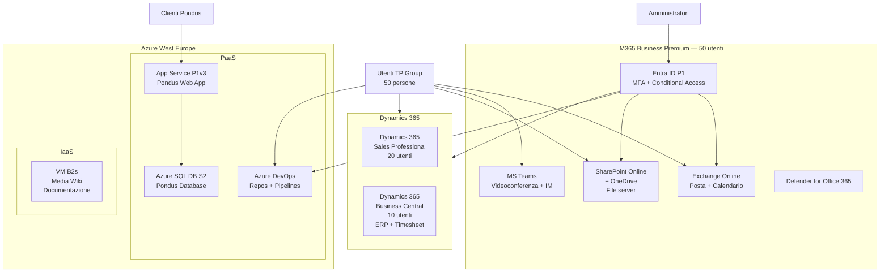

# 02 — Architettura TO-BE

> **Documento:** Architettura target Full Cloud Azure + Ecosistema Microsoft per TP Group  
> **Data:** Luglio 2026  
> **Regione Azure:** West Europe

---

## Schema architetturale

---

## Layer architetturale

### Layer 1 — Identità e Accesso (Entra ID)

| Componente | Descrizione |
|---|---|
| **Entra ID P1** | Identity provider unico per tutti i 50 utenti |
| **Entra Connect Sync** | Sincronizzazione da AD Samba4 esistente verso Entra ID |
| **MFA** | Conditional Access con MFA su tutte le app critiche |
| **Conditional Access** | Policy per location, device compliance, risk |

### Layer 2 — Produttività (M365 Business Premium)

| Componente | Descrizione |
|---|---|
| **Exchange Online** | Posta, calendario, contatti, 50 GB per utente |
| **SharePoint Online** | Siti dipartimentali e di progetto |
| **OneDrive** | Storage personale, 1 TB per utente |
| **MS Teams** | Chat, videoconferenza, canali per progetto |
| **Defender for Office 365** | Protezione phishing, malware, attachment sicuri |

### Layer 3 — Applicazioni Line of Business (Dynamics 365)

| Componente | Utenti | Descrizione |
|---|---|---|
| **Dynamics 365 Sales Professional** | 20 | CRM: pipeline vendita, opportunità, contatti |
| **Dynamics 365 Business Central Essentials** | 10 | ERP: contabilità, fatturazione, ciclo attivo/passivo |
| **Dynamics 365 Business Central** (incluso) | 10 | Timesheet, gestione progetti, integrazione ERP |

### Layer 4 — Applicazione Clienti (Azure PaaS)

| Componente | SKU | Descrizione |
|---|---|---|
| **Azure App Service P1v3** | Linux, 2 vCPU, 8 GB RAM | Pondus Web App (C#) |
| **Azure SQL Database S2** | 50 DTU, 250 GB storage | Pondus Database |

### Layer 5 — DevOps (Azure)

| Componente | Descrizione |
|---|---|
| **Azure DevOps Repos** | Repository Git centralizzato (da GiTea + BitBucket) |
| **Azure DevOps Pipelines** | CI/CD per Pondus e progetti interni |
| **Azure Artifacts** | Pacchetti NuGet/npm privati (se necessario) |

### Layer 6 — Documentazione (Azure IaaS)

| Componente | SKU | Descrizione |
|---|---|---|
| **VM B2s** | West Europe, 2 vCPU, 4 GB RAM | Media Wiki unificato, 30 GB managed disk |

---

## VNet e subnet

Rete virtuale Azure per servizi IaaS e integrazione VNet con App Service:

| Risorsa | Valore |
|---|---|
| Resource Group | `rg-tpgroup-migration-westeu` |
| VNet | `vnet-tpgroup-westeu` — 10.30.0.0/16 |
| Subnet Media Wiki | `snet-mediawiki-westeu` — 10.30.1.0/24 |
| Subnet App Service VNet integration | `snet-appsvc-westeu` — 10.30.2.0/24 |
| Subnet VPN Gateway | `snet-gateway-westeu` — 10.30.254.0/24 |
| VPN Gateway | VpnGw1AZ, active-standby |
