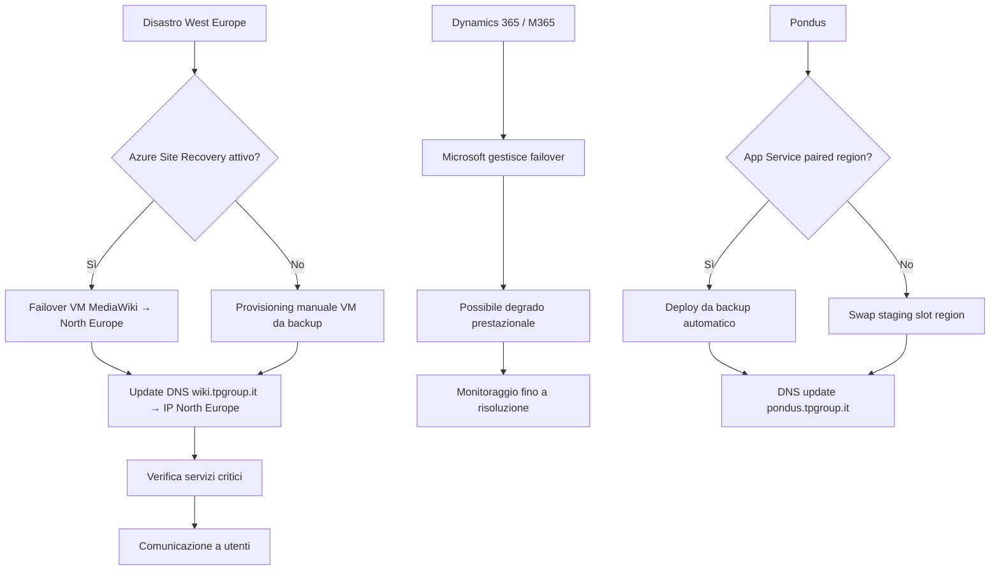

# Piano di Disaster Recovery — Full Cloud Azure

## Obiettivi

| Parametro | Target | Metodo |
|---|---|---|
| **RPO** (Recovery Point Objective) | ≤ 15 min (Azure SQL) / ≤ 24 ore (VM/file) | Azure SQL PITR / Azure Backup |
| **RTO** (Recovery Time Objective) | ≤ 4 ore (servizi critici) / ≤ 24 ore (servizi non critici) | Azure Site Recovery / Azure Backup restore |

## Classificazione servizi

### Critici (RPO ≤ 15 min, RTO ≤ 4 ore)

| Servizio | DR | Costrutto |
|---|---|---|
| **Azure SQL DB (Pondus)** | PITR + geo-replica | Failover automatico entro 1 ora |
| **Entra ID / M365 (posta, Teams)** | Ridondanza Microsoft nativa | Nessuna azione richiesta |
| **Dynamics 365** | Ridondanza nativa Microsoft | Nessuna azione richiesta |

### Importanti (RPO ≤ 24 ore, RTO ≤ 8 ore)

| Servizio | DR | Costrutto |
|---|---|---|
| **VM MediaWiki** | Azure Site Recovery → North Europe | Failover manuale < 4 ore |
| **App Service Pondus** | Backup + staging slot in paired region | Deploy da backup + DNS switch |
| **SharePoint / OneDrive** | M365 Backup + retention nativa | Restore da backup < 8 ore |

### Normali (RPO ≤ 24 ore, RTO ≤ 24 ore)

| Servizio | DR | Costrutto |
|---|---|---|
| **Azure DevOps** | Microsoft managed | Backup nativo illimitato |
| **HPC on-prem** | Dati job su Azure Blob | Replica job su nodi on-prem |

## Piano di risposta a scenari di disastro

### Scenario 1: Guasto Azure regionale (West Europe down)

| Fase | Azione | Tempo |
|---|---|---|
| Rilevamento | Azure Service Health alert | 15 min |
| Attivazione DR | Decisione PM + sistemista | 30 min |
| Failover VM MediaWiki → North Europe | Site Recovery failover | 1 ora |
| Restore Pondus (se necessario) | Deploy da backup | 2 ore |
| Verifica funzionalità servizi | Test utenti pilota | 1 ora |
| Rientro | Site Recovery commit o re-protect | 4 ore |

### Scenario 2: Attacco ransomware

| Fase | Azione | Tempo |
|---|---|---|
| Rilevamento | Defender for Office 365 / Defender for Cloud alert | Tempo reale |
| Isolamento | Conditional Access blocco account | 15 min |
| Valutazione danno | Audit log + backup scan | 2 ore |
| Restore dati M365 | M365 Backup (pulito) | 4 ore |
| Restore VM (se colpita) | Azure Backup restore (pulito) | 4 ore |
| Ripristino accessi | Reset password + MFA re-enroll | 4 ore |

### Scenario 3: Guasto HW sede (incendio, allagamento)

| Fase | Azione | Tempo |
|---|---|---|
| Rilevamento | Notifica da facility / personale | 30 min |
| Attivazione smart working totale | Azure VPN Client + Teams | 2 ore |
| Continuità servizi cloud | Nessun impatto su M365/Azure (tutto in cloud) | 0 |
| HPC fermo | Dati su Azure Blob, ricostruzione in Azure CycleCloud | 8 ore |
| Nuova sede | Attivazione piano logistica | Settimane |

## Test DR

| Test | Frequenza | Note |
|---|---|---|
| Test failover VM MediaWiki | Trimestrale | Site Recovery drill |
| Test restore Azure SQL DB | Trimestrale | PITR restore su DB di test |
| Test restore M365 (SharePoint) | Semestrale | Restore sito SharePoint di test |
| Test backup HPC | Semestrale | Restore dati job su nodi di test |
| Full DR test | Annuale | Simulazione disastro completo |

## Costi DR

| Voce | Costo/mese |
|---|---|
| Azure Site Recovery (VM B2s replicata) | ~€ 30 |
| Azure SQL geo-replica (opzionale) | ~€ 20 |
| Storage RA-GRS (incluso in backup) | Incluso |
| M365 Backup (opzionale) | ~€ 60 |
| **Totale DR** | **~€ 110/mese** |
