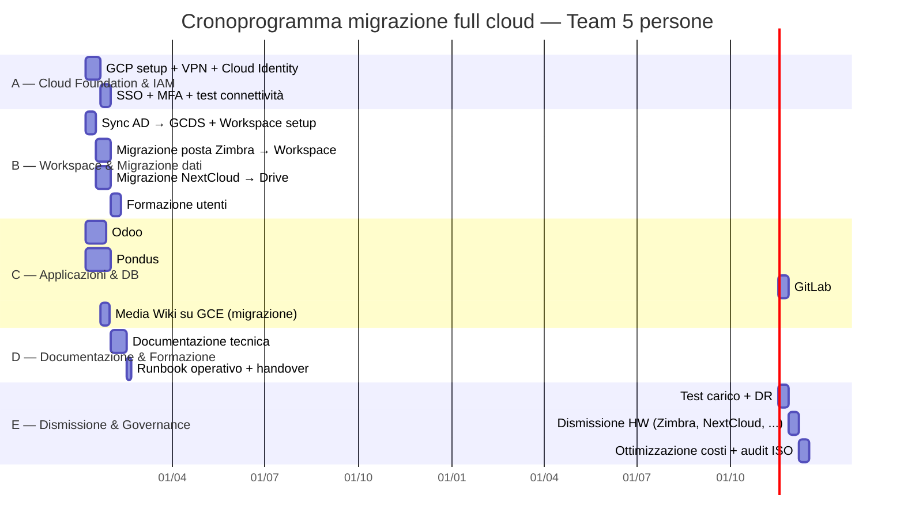

# Piano di Migrazione Full Cloud — TP Group

> **Obiettivo:** migrazione completa di tutti i servizi TP Group su Google Cloud Platform (GCP) e SaaS,
> con dismissione progressiva dell'infrastruttura on-premise in sede Torino.
> Budget totale progetto: € 520.000 + IVA.
> **Team:** 5 persone (1 PM/Architect + 2 Cloud Engineer + 1 System Integrator + 1 Workspace Specialist).

## Architettura TO-BE (full cloud)

```mermaid
graph TB
    subgraph ONPREM_DISMISSIONE["On-Premise — in fase di dismissione"]
        FG[Fortigate FG-60F<br/>Ultimo bridge]
        NAS[NAS QNAP<br/>Backup legacy]
    end

    subgraph GCP["GCP — Primary Cloud"]
        GCE_PONDUS[Compute Engine<br/>Pondus App VM]
        GCE_MEDIAWIKI[Compute Engine<br/>Media Wiki]
        GCE_BITBUCKET[Compute Engine<br/>Bit Bucket mirror → GitLab]
        CLOUD_SQL[Cloud SQL<br/>MS SQL / PostgreSQL]
        GCS[Cloud Storage<br/>File server → Drive]
        CLOUD_VPN[Cloud VPN Gateway]
        CLOUD_BACKUP[Cloud Storage<br/>Backup / DR]
        CLOUD_ID[Cloud Identity<br/>Identità / SSO]
        IAP[Identity-Aware Proxy<br/>Accesso sicuro]
    end

    subgraph SAAS["SaaS Esterni"]
        GW[Google Workspace<br/>Posta, Calendar, Drive, Meet]
        ODOO[Odoo<br/>Contabilità, CRM, Time Sheet]
        GITLAB[GitLab<br/>Versioning / CI/CD]
    end

    subgraph SEDE["Sede Torino — Clienti"]
        CLIENTI[Postazioni lavoro<br/>~40 utenti]
        HPC[Cluster HPC<br/>8+8 nodi<br/>(rimane on-premise)]
    end

    SEDE ---|VPN IPsec| CLOUD_VPN
    CLOUD_VPN --- GCP
    GCP --- SAAS
    HPC ---|VPN| GCP
    CLIENTI ---|Internet / SSO| SAAS
```

> **Nota:** Il cluster HPC rimane on-premise per requisiti prestazionali (simulazioni strutturali).
> Tutti gli altri servizi on-premise vengono migrati al cloud.

## Mappatura servizi: on-premise → cloud

| Servizio | Stato ATTUALE (on-premise) | TO-BE (cloud) | Piattaforma | Note |
| --- | --- | --- | --- | --- |
| **Posta / Calendario** | Zimbra | **Google Workspace** | SaaS | Migrazione caselle da Zimbra → Google |
| **Office** | MS365 / LibreOffice | **Google Workspace** | SaaS | Formazione su Google Docs/Sheets/Slides |
| **Videoconferenza** | MS Teams | **Google Meet** | SaaS | Transizione utenti Teams → Meet |
| **Autenticazione / IAM** | AD Samba4 | **Google Cloud Identity** | GCP/SaaS | AD → Cloud Identity con sync e SSO |
| **File server** | NextCloud | **Google Drive** | SaaS | Migrazione dati NextCloud → Drive + Shared Drive |
| **Contabilità** | Profis | **Odoo** | SaaS | Esportazione dati Profis → Odoo |
| **CRM** | Sugar CRM | **Odoo** | SaaS | Già in piano, resta confermato |
| **Time Sheet** | Kimai | **Odoo** | SaaS | Già in piano, resta confermato |
| **Versioning** | GiTea / Bit Bucket | **GitLab** (SaaS o GCP) | SaaS/GCP | Unificare su GitLab, self-hosted o cloud |
| **Documentazione** | Media Wiki (VM) | **Media Wiki su GCE** | GCP | Resta su VM GCP, backup automatico |
| **App Pondus** | Server dedicato (Xeon, 64GB) | **Cloud Run / GCE** | GCP | Containerizzazione o migrazione VM |
| **Backup locale** | NAS QNAP (32TB) | **Cloud Storage** | GCP | Nearline/Coldline per backup |
| **SAN virtualizzazione** | NetApp (24TB) | **Dismessa** | — | VM migrate su GCP |
| **Active Directory** | Samba4 VM | **Google Cloud Identity** | GCP | Sincronizzazione → dismissione |

## Team di progetto (5 persone)

| Ruolo | N° | Giorno/uomo | Competenze chiave | Assegnazione |
| --- | --- | --- | --- | --- |
| **Cloud Architect / PM** | 1 | € 650/g | Progettazione GCP, coordinamento, governance, risk management | Trasversale (full-time) |
| **Cloud Engineer** | 2 | € 500/g | GCP networking, IAM, Cloud Identity, VPN, automazione | Workstream A + E |
| **System Integrator** | 1 | € 500/g | Migrazione applicazioni (Pondus, Odoo, GitLab), DB migration | Workstream C |
| **Workspace & Data Specialist** | 1 | € 500/g | Google Workspace, migrazione posta/file, formazione utenti | Workstream B + D |

> Tutti e 5 collaborano alla **Fase di dismissione** (workstream E) nelle settimane finali.

## Workstream di migrazione (paralleli)

Grazie al team di 5 persone, i workstream **A, B, C** partono in parallelo dalla Settimana 1.
Il PM coordina trasversalmente tutti i workstream.



### Workstream A — Cloud Foundation & IAM (1 persona · Settimane 1-4)

**Assegnato a:** Cloud Engineer 1
**Attività:**

- [ ] Attivare progetto GCP `tp-group-production` con organization e folder (prod, staging, backup)
- [ ] Configurare Cloud VPN Gateway + tunnel IPsec verso Fortigate sede Torino
- [ ] Abilitare Google Cloud Identity Premium per 50 utenti
- [ ] Configurare IAM: ruoli, account di servizio, policy, tag gerarchici
- [ ] Verificare connettività VPN e latenza tra sede e GCP
- [ ] Allocare budget alert (soglie: 50%, 75%, 90%, 100%)
- [ ] **Milestone A:** Infrastruttura GCP pronta, connettività verificata, identità cloud attiva

### Workstream B — Workspace & Migrazione dati (1 persona · Settimane 1-6)

**Assegnato a:** Workspace & Data Specialist
**Attività:**

- [ ] Sincronizzare AD Samba4 → Google Cloud Identity via GCDS (parallelo con W/A)
- [ ] Configurare SAML SSO: Workspace federato con Cloud Identity
- [ ] Abilitare MFA (Google Authenticator / Titan Security Key) per tutti i 50 utenti
- [ ] Migrare caselle postali Zimbra → Google Workspace (GWMME, batch progressivi)
- [ ] Configurare Google Drive: quote, policy DLP, Shared Drive per reparto
- [ ] Trasferire dati NextCloud → Drive/Shared Drive (rclone su VM GCP temporanea)
- [ ] Ridondanza: backup su Cloud Storage Nearline prima del cutover
- [ ] Organizzare periodo coesistenza: NextCloud in sola lettura per 30 giorni
- [ ] Verificare MX record DNS per posta in arrivo
- [ ] **Milestone B:** Tutti gli utenti su Workspace, posta e file migrati, MFA attivo

### Workstream C — Applicazioni & DB (2 persone · Settimane 1-8)

**Assegnato a:** Cloud Engineer 2 + System Integrator

**Sotto-workstream C1 — Odoo (System Integrator)**

- [ ] Esportare dati da **Profis** (contabilità) in formato compatibile Odoo
- [ ] Esportare dati da **Sugar CRM** e **Kimai** → mappatura campi e import in Odoo
- [ ] Configurare Odoo: utenti, permessi, integrazione SSO (SAML se supportato)
- [ ] Verificare quadratura contabile: report di controllo pre/post migrazione

**Sotto-workstream C2 — Pondus App (Cloud Engineer 2)**

- [ ] Assessment: analisi dipendenze app (.NET framework vs core, IIS features) 
- [ ] Decisione architetturale: containerizzazione (Docker → Cloud Run) VS lift-and-shift (VM GCE)
- [ ] Migrare database MS SQL → Cloud SQL (SQL Server 2022, High Availability)
- [ ] Deploy della app su GCE / Cloud Run con bilanciatore HTTPS (global HTTP LB)
- [ ] Verificare connettività clienti esterni a Pondus (CDN abilitata se latenza >200ms)

**Sotto-workstream C3 — Git & Documentazione (System Integrator, post Odoo)**

- [ ] Migrare repository: Bit Bucket + GiTea → **GitLab** (SaaS o self-hosted su GCE)
- [ ] Configurare CI/CD su GitLab per Pondus e progetti correlati
- [ ] Migrare Media Wiki da VM GCP esistente a immagine aggiornata su GCE
- [ ] **Milestone C:** Applicazioni aziendali su cloud, Odoo operativo, Pondus live

### Workstream D — Formazione & Documentazione tecnica (1 persona · Settimane 4-8)

**Assegnato a:** Workspace & Data Specialist (post Workspace)
**Attività:**

- [ ] Preparare materiale formativo: guide rapida Workspace (posta, drive, meet, docs)
- [ ] Erogare workshop utenti: 3 sessioni da 2h (base, avanzato, Q&A)
- [ ] Identificare 2-3 power user ambassador per supporto interno
- [ ] Documentare procedure operative: backup, restore, gestione utenti
- [ ] Redigere runbook GCP per il team IT (in caso di incidenti)
- [ ] **Milestone D:** Utenti formati, documentazione operativa completa

### Workstream E — Dismissione & Governance (tutto il team · Settimane 8-12)

**Coordinato da:** Cloud Architect / PM

- [ ] Test di carico su Pondus e servizi critici (tutto il team partecipa)
- [ ] Eseguire test di Disaster Recovery: restore completo da Cloud Storage
- [ ] **Dismissione (Cloud Engineer 1 + System Integrator):**
  - [ ] Zimbra, NextCloud, GiTea — backup finale e spegnimento
  - [ ] Sugar CRM, Kimai — conferma dati importati in Odoo, disdetta licenze
  - [ ] Profis — esportazione archivio storico, dismissione
  - [ ] Server fisici non più necessari (riduzione TCO e spazio in sede)
- [ ] Riconfigurare Fortigate: solo connettività HPC + VPN backup ridondante
- [ ] **Governance (Cloud Architect / PM):**
  - [ ] Analizzare costi GCP: ottimizzare con committed use discounts, preemptible VM
  - [ ] Configurare budget alert definitivi + reportistica mensile
  - [ ] Implementare backup policy automatizzate (Cloud Scheduler + Cloud Functions)
  - [ ] Verificare compliance ISO 27001 su cloud (audit checklist finale)
- [ ] **Milestone E:** On-premise dismesso, governance attiva, costi sotto controllo

## Riepilogo tempistiche

| Workstream | Assegnato | Durata | Inizio | Fine |
| --- | --- | --- | --- | --- |
| **A** — Cloud Foundation & IAM | Cloud Engineer 1 | 4 settimane | Settimana 1 | Settimana 4 |
| **B** — Workspace & Migrazione dati | Workspace Specialist | 6 settimane | Settimana 1 | Settimana 6 |
| **C** — Applicazioni & DB | Cloud Engineer 2 + System Integrator | 8 settimane | Settimana 1 | Settimana 8 |
| **D** — Formazione & Documentazione | Workspace Specialist | 4 settimane | Settimana 4 | Settimana 8 |
| **E** — Dismissione & Governance | Tutto il team | 4 settimane | Settimana 8 | Settimana 12 |

> **Durata totale progetto: 12 settimane** (invece delle 12 sequenziali del piano ibrido, qui 5 workstream lavorano in parallelo con 5 persone, ottenendo più lavoro nello stesso tempo).

## Cosa rimane on-premise

| Servizio | Motivazione |
| --- | --- |
| **Cluster HPC** (8+8 nodi, Infiniband) | Latenza Infiniband non replicabile su cloud. Simulazioni strutturali richiedono risorse dedicate a bassa latenza |
| **Fortigate FG-60F/100F** | Connettività VPN sede → cloud + connettività HPC |
| **NAS QNAP** (fase-out) | Backup locale temporaneo, poi solo cloud |

## Rischi e rollback

| Rischio | Probabilità | Impatto | Contromisura | Rollback |
| --- | --- | --- | --- | --- |
| **Latenza Pondus** per clienti esterni | Media | Alto | Test di carico pre-migrazione + Cloud CDN | Mantenere VM on-premise in parallelo 30gg |
| **Perdita dati Profis → Odoo** | Bassa | Alto | Backup completo esportazione Profis | Ripristinare Profis su VM GCP |
| **Migrazione posta Zimbra → Workspace** | Media | Medio | GWMME test batch, periodo coesistenza | MX record puntano ancora a Zimbra |
| **Resistenza utenti al cambio strumenti** | Alta | Medio | Formazione graduale, power user ambassador | Mantenere MS365 in parallelo 60gg |
| **Costi cloud fuori controllo** | Media | Medio | Budget alert + tag per reparto | Spegnere risorse non essenziali |
| **Downtime connettività VPN** | Media | Alto | VPN ridondante (2 tunnel) + accesso diretto SaaS | Utenti lavorano da remoto su Workspace/Odoo |
| **HPC incompatibile con backup cloud** | Bassa | Basso | Backup risultati su Cloud Storage via rsync programmato | Mantenere backup locale NAS |
| **Coordinamento 5 persone su workstream paralleli** | Media | Medio | Daily standup 15', PM assegnato, WBS condivisa | Riallineamento settimanale |

## Gap Analysis ISO/IEC 27001:2022

Il piano di migrazione full cloud **da solo NON basta** per ottenere la certificazione ISO 27001.
Copre principalmente controlli tecnologici (Annex A.8) ma ignora quasi totalmente i controlli
organizzativi (A.5), people (A.6) e fisici (A.7) richiesti dallo standard.

Di seguito l'analisi per macro-area. Legenda: ✅ coperto — ◐ parziale — ❌ assente — N/A non applicabile

### A.5 — Controlli Organizzativi (37 controlli)

| Controllo | Stato | Cosa manca |
| --- | --- | --- |
| **5.1** Politica sicurezza informazioni | ❌ | Nessuna policy scritta definita o in programma |
| **5.2** Ruoli e responsabilità sicurezza | ◐ | PM definito, ma non un CISO / Security Officer dedicato |
| **5.3** Segregazione dei compiti | ❌ | Non affrontata (es. chi deploya Pondus non dovrebbe autorizzare il deploy) |
| **5.4** Responsabilità direzione | ❌ | Nessun management commitment documentato |
| **5.5** Contatto con autorità | ❌ | Nessun contatto con Garante Privacy / CERT definito |
| **5.6** Contatto con gruppi di interesse | ❌ | Nessuna partecipazione a threat intelligence community |
| **5.7** Threat intelligence | ❌ | Nessuna raccolta sistematica di informazioni su minacce |
| **5.8** Security in project management | ◐ | Il piano stesso è un project plan, ma senza security gate formali |
| **5.9** Inventario risorse | ❌ | Nessun asset register definito (HW, SW, dati) |
| **5.10** Uso accettabile risorse | ❌ | Nessuna policy AUP (acceptable use policy) |
| **5.11** Restituzione risorse | ❌ | Nessuna procedura per fine rapporto/contratto |
| **5.12** Classification of information | ❌ | Nessuna classificazione (pubblico, interno, riservato, segreto) |
| **5.13** Labelling of information | ❌ | Nessuna etichettatura dei dati |
| **5.14** Information transfer | ◐ | VPN cifrata, ma nessuna policy su trasferimento dati a terzi |
| **5.15** Access control | ◐ | Cloud Identity + IAM definiti, ma manca una policy formale di accesso |
| **5.16** Identity management | ◐ | Cloud Identity come IdP, ma manca ciclo di vita (onboarding/offboarding) |
| **5.17** Authentication information | ◐ | MFA presente ma manca policy su password, reset, gestione credenziali |
| **5.18** Privileged access | ◐ | IAM definito, ma manca controllo periodico degli accessi privilegiati |
| **5.19** Information security in supplier relations | ❌ | GCP, Odoo, GitLab sono fornitori critici: nessun SLA di sicurezza o DPIA |
| **5.20** Acuerdo con fornitori | ❌ | Nessun contratto con clausole di sicurezza / DPA |
| **5.21** Gestione sicurezza supply chain | ❌ | Nessuna valutazione della catena di fornitura |
| **5.22** Monitoraggio fornitori | ❌ | Nessuna verifica periodica della conformità fornitori |
| **5.23** Usage of cloud services | ❌ | Nessuna policy cloud, nessun CASB, nessun controllo su Shadow IT |
| **5.24** Incident management | ❌ | Nessun processo di incident response definito |
| **5.25** Assessment of events | ❌ | Nessuna classificazione eventi di sicurezza |
| **5.26** Response to incidents | ❌ | Nessun playbook di risposta |
| **5.27** Learning from incidents | ❌ | Nessun processo di post-mortem / lessons learned |
| **5.28** Collection of evidence | ❌ | Nessuna procedura di acquisizione prove forensi |
| **5.29** Business continuity | ◐ | DR test pianificato, ma manca BIA (Business Impact Analysis) e BCP completo |
| **5.30** ICT readiness for BC | ❌ | Nessun piano di continuità per i sistemi ICT |
| **5.31** Legal, statutory, regulatory compliance | ❌ | Nessuna mappatura dei requisiti legali (GDPR, settore automotive/aerospace) |
| **5.32** Intellectual property | ❌ | Nessuna gestione della proprietà intellettuale |
| **5.33** Protection of records | ◐ | Backup su Cloud Storage, ma manca retention policy formale |
| **5.34** Privacy and PII protection | ❌ | Nessuna valutazione GDPR / DPIA sui nuovi servizi cloud |
| **5.35** Independent review of ISMS | ❌ | Nessun audit interno programmato |
| **5.36** Compliance with policies | ❌ | Nessun processo di verifica periodica dell'adesione alle policy |
| **5.37** Documented procedures | ❌ | Nessuna procedura operativa documentata (runbook in programma al Workstream D) |

### A.6 — Controlli People (8 controlli)

| Controllo | Stato | Cosa manca |
| --- | --- | --- |
| **6.1** Screening | ❌ | Nessuna procedura di background check / controlli pre-assunzione |
| **6.2** Terms and conditions of employment | ❌ | Nessuna clausola di sicurezza nei contratti |
| **6.3** Information security awareness | ◐ | Formazione utenti su Workspace pianificata, ma non su sicurezza |
| **6.4** Disciplinary process | ❌ | Nessun procedimento disciplinare per violazioni |
| **6.5** Responsibilities post-employment | ❌ | Nessuna procedura di revoca accessi a fine rapporto |
| **6.6** Confidentiality agreements | ❌ | Nessun NDA / accordo di riservatezza |
| **6.7** Remote working | ❌ | Nessuna policy per lavoro remoto (rilevante dato il cloud) |
| **6.8** Security events reporting | ❌ | Nessun canale per segnalare eventi di sicurezza |

### A.7 — Controlli Fisici (14 controlli)

| Controllo | Stato | Cosa manca |
| --- | --- | --- |
| **7.1-7.7** Perimetri fisici, accesso, uffici | ✅ N/A | Infrastruttura su GCP, responsabilità fisica del provider |
| **7.8** Equipment siting and protection | ❌ | Cluster HPC in sede: nessuna protezione fisica documentata |
| **7.9** Security of assets off-premises | ❌ | Nessuna policy per dispositivi fuori sede |
| **7.10** Storage media | ❌ | Nessuna procedura per supporti di memorizzazione (NAS QNAP fase-out) |
| **7.11** Media disposal | ❌ | Nessuna distruzione sicura dei supporti a fine vita |
| **7.12** Cabling security | ❌ | Infiniband e cablaggio HPC senza documentazione |
| **7.13** Equipment maintenance | ❌ | Nessuna manutenzione preventiva documentata per HPC e Fortigate |
| **7.14** Equipment removal | ❌ | Nessuna procedura per rimozione HW dalla sede |

### A.8 — Controlli Tecnologici (34 controlli)

| Controllo | Stato | Cosa manca |
| --- | --- | --- |
| **8.1** User endpoint devices | ❌ | Nessuna gestione dei dispositivi utente (MDM/UEM) |
| **8.2** Privileged access rights | ◐ | IAM su GCP definito, ma manca revisione periodica |
| **8.3** Information access restriction | ◐ | Cloud Identity + IAP, ma manca una matrice accessi formale |
| **8.4** Access to source code | ◐ | GitLab con accesso controllato, ma manca policy formale |
| **8.5** Secure authentication | ◐ | SSO + MFA presenti (coperto) |
| **8.6** Capacity management | ❌ | Nessun monitoring della capacità (GCP risorse, cloud SQL, etc.) |
| **8.7** Protection against malware | ❌ | Nessuna soluzione EDR/AV definita (né su cloud né su endpoint) |
| **8.8** Management of technical vulnerabilities | ❌ | Nessun processo di vulnerability scanning / patch management |
| **8.9** Configuration management | ❌ | Nessuna baseline di configurazione (GCP, Fortigate, Cloud SQL) |
| **8.10** Information deletion | ❌ | Nessuna procedura di cancellazione sicura dei dati |
| **8.11** Data masking | ❌ | Non affrontato (dati sensibili clienti automotive/aerospace) |
| **8.12** Data leakage prevention (DLP) | ◐ | DLP su Google Drive menzionato, ma non per tutti i canali |
| **8.13** Information backup | ◐ | Cloud Storage configurato, ma mancano RPO/RTO formalizzati |
| **8.14** Redundancy of processing facilities | ◐ | Cloud SQL HA + VPN ridondante, ma non per tutti i servizi |
| **8.15** Logging | ❌ | Nessun logging centralizzato definito (Cloud Logging? SIEM?) |
| **8.16** Monitoring activities | ❌ | Nessun monitoring in tempo reale delle attività sospette |
| **8.17** Clock synchronization | ❌ | NTP non menzionato |
| **8.18** Use of privileged utility programs | ❌ | Nessun controllo sull'uso di strumenti privilegiati |
| **8.19** Installation of software on operational systems | ❌ | Nessuna policy di change management / deployment |
| **8.20** Networks security management | ◐ | VPN + IAP, ma manca segmentazione rete su GCP (VPC SC?) |
| **8.21** Security of network services | ❌ | Nessuna valutazione della sicurezza dei servizi di rete |
| **8.22** Segregation of networks | ◐ | Folder GCP (prod/staging/backup) ma manca network segmentation |
| **8.23** Web filtering | ❌ | Non menzionato |
| **8.24** Use of cryptography | ❌ | Nessuna policy crittografica: chi cifra cosa, con quali algoritmi, gestione chiavi |
| **8.25** Secure development life cycle | ❌ | Nessun security gate nel CI/CD (GitLab menzionato ma senza SAST/DAST) |
| **8.26** Application security requirements | ❌ | Nessun requisito di sicurezza per Pondus / Odoo |
| **8.27** Secure system architecture | ❌ | Nessuna review architetturale della sicurezza |
| **8.28** Secure coding | ❌ | Nessuna guida/standard di secure coding |
| **8.29** Security testing in dev/acceptance | ❌ | Nessun penetration test o vulnerability assessment pianificato |
| **8.30** Outsourced development | ❌ | Non applicabile (tutto interno) |
| **8.31** Separation of test/production | ◐ | Folder GCP separati, ma mancano ambienti di test formali |
| **8.32** Change management | ❌ | Nessun processo di change management |
| **8.33** Test information | ❌ | Nessuna protezione dei dati di test (potrebbero contenere PII) |
| **8.34** Protection of audit logs | ❌ | Nessuna retention/protezione dei log di audit |

### Riepilogo gap

| Area | Totale controlli | ✅ Coperti | ◐ Parziali | ❌ Assenti | N/A |
| --- | --- | --- | --- | --- | --- |
| **A.5** Organizzativi | 37 | 0 | 8 | 29 | 0 |
| **A.6** People | 8 | 0 | 1 | 7 | 0 |
| **A.7** Fisici | 14 | 8 (N/A su cloud) | 0 | 6 | 8 |
| **A.8** Tecnologici | 34 | 0 | 14 | 20 | 0 |
| **Totale** | **93** | **8** | **23** | **62** | **8** |

> **Verdetto:** Il piano copre solo **~25% dei controlli** (e perlopiù in modo parziale).
> La voce "Consulenza sicurezza ISO 27001 — € 5.000" nel budget è **largamente insufficiente**.

### Cosa serve in più per la certificazione

| Attività | Giorni/uomo | Costo stimato | Chi |
| --- | --- | --- | --- |
| **1. Gap analysis iniziale** (già in budget) | 10 | € 5.000 | Consulente esterno |
| **2. Definizione ISMS**: policy, scope, risk assessment, SoA | 25 | € 15.000 | Consulente + PM |
| **3. Stesura documentazione obbligatoria**: manuale ISMS, procedure, registri | 20 | € 12.000 | Consulente |
| **4. Implementazione controlli mancanti**: logging, vulnerability mgmt, change mgmt, MDM, endpoint protection, cryptography | 40 | € 24.000 | Cloud Engineer 1+2 |
| **5. Security awareness program** | 10 | € 5.000 | Workspace Specialist |
| **6. Internal audit** (pre-certificazione) | 10 | € 6.000 | Consulente |
| **7. External certification audit** (ente accreditato) | — | € 15.000 | Ente certificatore |
| **8. Tooling** (SIEM, EDR, GRC platform) | — | € 8.000/anno | Licenze |
| --- | --- | --- | --- |
| **Costo aggiuntivo per ISO 27001** | | **~€ 90.000** (+ € 8.000/anno tooling) | |

> **Impatto sul budget totale:** € 187.000 (migrazione) + € 90.000 (ISO 27001) = **€ 277.000**
> ❌ **Sfora il budget** di € 57.000.
>
> Possibili azioni:
> - **Opzione A** — Ridurre il perimetro di certificazione (es. solo servizi cloud, escludendo HPC e sviluppo)
> - **Opzione B** — Distribuire i costi su 2 anni (anno 1: migrazione + gap analysis + ISMS; anno 2: implementazione + audit)
> - **Opzione C** — Ripensare l'offerta ibrida (il risparmio HW può finanziare parte della compliance)

## Stima costi migrazione

### Costi team di progetto (5 persone — 12 settimane)

| Ruolo | Giorni/uomo | Tariffa | Costo |
| --- | --- | --- | --- |
| **Cloud Architect / PM** — coordinamento, governance, risk | 40 | € 650/g | € 26.000 |
| **Cloud Engineer 1** — foundation GCP, IAM, dismissione | 48 | € 500/g | € 24.000 |
| **Cloud Engineer 2** — Pondus, DB, CI/CD, dismissione | 48 | € 500/g | € 24.000 |
| **System Integrator** — Odoo, GitLab, Media Wiki, dismissione | 44 | € 500/g | € 22.000 |
| **Workspace & Data Specialist** — Workspace, migrazione dati, formazione | 50 | € 500/g | € 25.000 |
| --- | --- | --- | --- |
| **Totale personale** | **230 gg/u** | | **€ 121.000** |

### Costi cloud e licenze (primo anno)

| Voce | Costo |
| --- | --- |
| **Google Workspace Business** (50 utenti × €12/mese × 12 mesi) | € 7.200 |
| **Google Cloud Identity Premium** (50 utenti × €6/mese × 12 mesi) | € 3.600 |
| **GCP risorse di calcolo** (Pondus, Media Wiki, GitLab, servizi) | ~€ 18.000/anno |
| **Cloud SQL** (MS SQL Server, 16GB RAM, 500GB SSD) | ~€ 9.600/anno |
| **Cloud Storage** (backup Nearline/Coldline, 10TB) | ~€ 1.800/anno |
| **Traffico VPN e rete** (GCP egress) | ~€ 2.400/anno |
| **Odoo SaaS** (contabilità + CRM + timesheet, 50 utenti) | ~€ 9.600/anno |
| **GitLab SaaS** (Premium, 50 utenti) | ~€ 4.800/anno |
| --- | --- |
| **Costi cloud ricorrenti (stimati)** | **~€ 57.000/anno** |

### Costi una tantum

| Voce | Costo |
| --- | --- |
| **Formazione utenti** (5 giornate workshop + materiale) | € 2.500 |
| **Gap analysis ISO 27001** (assessment iniziale, già in budget) | € 5.000 |
| **Traffico VPN migrazione** (GCP egress extra) | € 1.500 |
| **Costi una tantum (migrazione)** | **€ 9.000** |

### Riepilogo — Scenario A: migrazione senza certificazione ISO 27001

| Voce | Costo |
| --- | --- |
| Team di progetto (5 persone, 12 settimane) | € 121.000 |
| Cloud e licenze (primo anno) | € 57.000 |
| Una tantum (migrazione) | € 9.000 |
| **TOTALE PRIMO ANNO** | **~€ 187.000** ✅ *(entro budget € 520k, margine € 333k)* |
| **TOTALE ANNI SUCCESSIVI** (solo cloud + licenze) | **~€ 57.000/anno** |

### Riepilogo — Scenario B: migrazione + certificazione ISO 27001

| Voce | Costo |
| --- | --- |
| Team di progetto (5 persone, 12 settimane) | € 121.000 |
| Cloud e licenze (primo anno) | € 57.000 |
| Una tantum (migrazione) | € 9.000 |
| **Implementazione ISO 27001** (ISMS, policy, controlli tecnologici mancanti) | ~€ 62.000 |
| **Audit di certificazione** (interno + ente esterno) | ~€ 21.000 |
| **Tooling sicurezza** (SIEM, EDR, GRC, primo anno) | ~€ 8.000 |
| **TOTALE PRIMO ANNO** | **~€ 278.000** ✅ *(entro budget € 520k, margine € 242k)* |
| **TOTALE ANNI SUCCESSIVI** | **~€ 65.000/anno** (+€ 8k tooling sicurezza) |

> ✅ **Con il budget di €520k, la certificazione ISO 27001 nel primo anno è perfettamente realizzabile.**
> Soluzione consigliata: **Piano annuale** — con il budget di €520k, tutte le attività (migrazione + ISO 27001 + tooling) rientrano nel primo anno con ampio margine.

## Confronto: Full Cloud vs Ibrido (con team 5 persone)

| Voce | Full Cloud | Ibrido* | Differenza |
| --- | --- | --- | --- |
| **Costo personale (12 settimane, 5 persone)** | € 121.000 | ~€ 100.000 | -€ 21k (ibrido meno attività) |
| **Costo cloud/license primo anno** | € 57.000 | ~€ 35.000 | +€ 22k (full cloud più servizi) |
| **Costi una tantum** | € 9.000 | ~€ 20.000 | -€ 11k (più HW ibrido) |
| **Costo primo anno** | **~€ 187.000** | **~€ 155.000** | **+€ 32k full cloud** |
| **Costo ricorrente/anno** | **~€ 57.000** | **~€ 45.000** | **+€ 12k/anno full cloud** |
| **Manutenzione HW** | Nessuna (HW dismesso) | Server, NAS, SAN, rete | Risparmio significativo |
| **Scalabilità** | Istantanea (GCP) | Acquisto hardware | Vantaggio cloud |
| **Compliance ISO 27001** | Certificazioni GCP (SOCs, ISO) | Responsabilità interna | Vantaggio cloud |
| **Magazzino hardware** | Zero | Server, NAS, ricambi | Vantaggio cloud |
| **Dipendenza Internet** | Alta | Media | Svantaggio cloud |
| **Lock-in** | GCP/Google Workspace | Misto | Neutro |

*\* Ibrido: stima con stesso team 5 persone ma 10 settimane (meno migrazioni) + HW on-premise (€ 15-20k in NAS/server) + licenze on-premise.*

## Checklist verifica pre-dismissione

- [ ] Tutti i 50 utenti hanno account Workspace attivo
- [ ] Posta: MX record aggiornati, vecchia casella Zimbra scaricata
- [ ] File: NextCloud svuotato, dati su Drive/Shared Drive verificati
- [ ] Contabilità: Odoo operativo con dati Profis importati
- [ ] Pondus: accessibile via HTTPS pubblico, DB su Cloud SQL
- [ ] GitLab: tutti i repository migrati, CI/CD funzionante
- [ ] Media Wiki: contenuti visibili, backup automatico attivo
- [ ] Backup: Cloud Storage configurato con policy 3-2-1
- [ ] DR test: restore completo eseguito e documentato
- [ ] AD Samba4: dismesso, tutte le utenze su Cloud Identity
- [ ] Fortigate: riconfigurato per solo HPC + VPN ridondanza
- [ ] Fatturazione: budget alert attivo, tag per reparto
